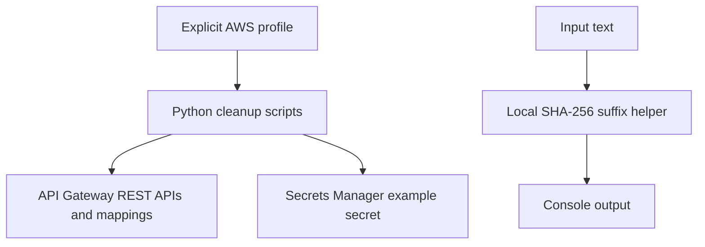

# Scripts Library

Small Python utilities for cleaning up selected AWS resources after infrastructure experiments and producing a short deterministic hash suffix for example values.

**Status:** The cleanup scripts perform real deletions. The API script removes REST APIs and base-path mappings; the secret script force-deletes a hard-coded example secret without recovery. Both use the selected AWS profile and a hard-coded Region.

## Architecture

## Start here

Read [delete_api.py](Deletion/delete_api.py) and [delete_secrets.py](Deletion/delete_secrets.py) before any execution; there is no dry-run mode or complete pagination. The local example `python Sanitization/sanitize_rego_values.py` makes no AWS calls. See the reference guide for the cleanup rationale and invocation details.

[Previous README and detailed reference](https://github.com/mtzanida/scripts-library/blob/3f387f9ec04640b09df32907d9faa8fd7421d3e0/readme.md) are retained in Git history. They may describe older assumptions or unmerged plans; the scope above reflects this branch.
